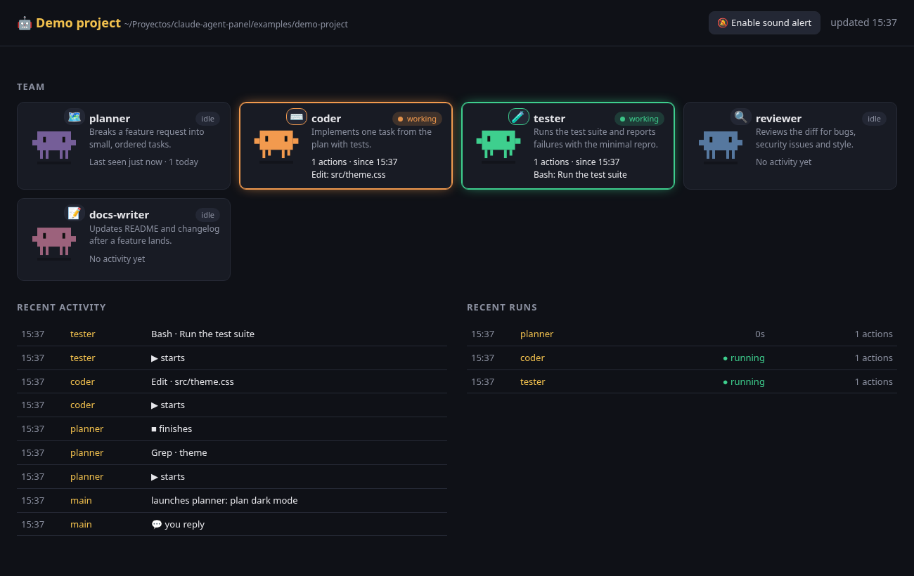

# Claude Agent Panel

A live web dashboard for your [Claude Code](https://claude.com/claude-code) subagents. You can see who is working, what they are doing right now, and get a bell when Claude is waiting for you.



- **Team view**: every agent in `.claude/agents/` (project and user level) gets a little pixel critter. It jumps while the agent works and shows the agent's current action. Built-in agents such as `Explore` or `general-purpose` show up once they are used.
- **"Your turn" alert**: a banner, an optional chime and a desktop notification when Claude finishes, asks for permission or asks you a question. It works across several sessions.
- **Activity log and run history**: every tool call, plus how long each subagent ran and how many actions it took.
- **Multi-project**: one install covers every project, and you pick the project from a dropdown.
- **Zero dependencies**: one Python file (3.10+, standard library only) and one HTML page. Nothing leaves your machine, and the server listens on `127.0.0.1` only.
- The UI is in English or Spanish, following your browser's language (or `?lang=es` / `?lang=en`).

## Install

```bash
git clone https://github.com/jesuggc/claude-agent-panel.git
cd claude-agent-panel
python3 agent_panel.py install          # adds the hooks to ~/.claude/settings.json (all projects)
# or: python3 agent_panel.py install --project /path/to/project   (only that project)
```

Restart your Claude Code sessions so they load the hooks, then start the panel:

```bash
python3 agent_panel.py                  # opens http://127.0.0.1:8765
python3 agent_panel.py --port 9000 --no-browser
```

Keep the cloned folder where it is, because the hooks point to this file. If you move it, run `install` again.
`install` keeps your other hooks and saves a `settings.json.bak` first. Running it twice does not add the hooks twice.

To remove it: `python3 agent_panel.py uninstall` (add `--project DIR` if you installed it per project).

Want to see it without Claude Code? `examples/demo.sh` feeds fake events into a throwaway log and opens the panel.

## How it works

```
Claude Code ──hook events──▶ agent_panel.py hook ──▶ ~/.claude/agent-panel/logs/<project>.jsonl
                                                                   │
browser ◀── /api/state (every 2 s) ◀── agent_panel.py (serve) ◀────┘  + .claude/agents/*.md
```

The hooks (`UserPromptSubmit`, `PreToolUse`, `SubagentStart`, `SubagentStop`, `Stop`, `Notification` and `SessionEnd`) run asynchronously and never block Claude. Each one appends a short JSON line. Logs are trimmed automatically. Set `AGENT_PANEL_HOME` to store them somewhere else.

An agent counts as stopped after `SubagentStop` or after 20 minutes without events.

## Customising

The panel reads `name`, `description` and `color` from each agent's frontmatter. `color` can be a Claude Code colour name or a `#hex` value. For a custom title, icons, short role labels or a fixed order, add `.claude/agent-panel.json` to the project:

```json
{
  "title": "My YouTube channel",
  "agents": {
    "scout":     {"icon": "🔭", "color": "#3ECF8E", "role": "Finds topics with traction"},
    "guionista": {"icon": "✍️", "role": "Writes the script"}
  }
}
```

Agents listed there come first, in that order. See [`examples/`](examples/).

## En español

Panel web en local para ver en directo qué hacen tus subagentes de Claude Code y recibir un aviso ("Te toca") cuando Claude te espera.
Para instalarlo, ejecuta `python3 agent_panel.py install` y reinicia Claude Code. Para abrir el panel, ejecuta `python3 agent_panel.py`. Puedes personalizar el título, los iconos y el orden con `.claude/agent-panel.json`.

## License

MIT
